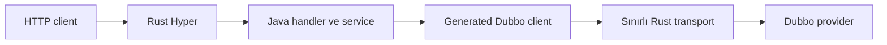

# rest-sample-dubbo-consumer

## 0.8.1 Sürümü

Yayımlanmış sample 0.8.1, REST/platform 4.8.1, Dubbo 0.9.1 ve model 0.5.1 kullanır. ARM manifesti
düzeltmesini içerir. İş kodu ve native ABI'ler değişmez.
Önceki 0.8.0 sürüm notları tarihsel kayıttır.
[Düzeltme notları](docs/RELEASE_NOTES_v0.8.1.tr.md).

[English](README.md) | [Türkçe](README.tr.md)

## Compose

**Henüz yayımlanmamış kaynak akışı.** Bu topoloji ve aşağıdaki yeni yardımcı API
örnekleri birlikte güncellenmiş kaynakları gerektirir; yayımlanmış sample `0.8.1`
tek başına yeterli değildir. Uyumlu REST/platform, cache ve Dubbo kaynak bağımlılıkları
önceden kurulmuş veya çözülebilir olmalıdır. `--prepare` / `-Prepare` sample'ları
paketler; bu framework bağımlılıklarını derlemez. Yeni JNI export'ları için eşleşen
REST native kaynakları da gerekir; mevcut ABI numaraları değişmez. Kubernetes
doğrulaması Compose motorunun çalıştırıldığına kanıt değildir; bu tarif ARM
donanımının doğrulandığı anlamına da gelmez.

Ortak topoloji, yan yana alınmış `rest-sample-cache-reader/docker/compose/` içindedir;
[tam rehberi](https://github.com/esasmer-dou/rest-sample-cache-reader/blob/master/README.tr.md#compose)
inceleyin. Dört sample deposunu kendi adlarıyla aynı üst dizinde tutun.
Linux/amd64 Docker Engine, `--wait` destekli Compose v2, JDK 21/Maven ve çözülebilen
uyumlu bağımlılıklar gerekir. Bash için `curl`, `jq`, `timeout`; PowerShell için
sürüm 7 kullanın. Bu deponun kök dizininden:

```bash
bash ../rest-sample-cache-reader/scripts/verify-compose-topology.sh --prepare
# Alternatif: native katalog provider + native-static-consumer
bash ../rest-sample-cache-reader/scripts/verify-compose-topology.sh --prepare --native-provider
```

PowerShell: `pwsh -File ../rest-sample-cache-reader/scripts/verify-compose-topology.ps1 -Prepare`
(alternatif için `-NativeProvider` ekleyin). Hazırlık, dört sample'ı testleri
çalıştırmadan paketler ve runtime bağımlılıklarını kopyalar. Varsayılan eşleşme
`full-dubbo-consumer` / `full-provider` olur. POST/PATCH provider RPC üzerinden
PostgreSQL'e yazılır; writer fenced Redis snapshot'ı yayınlar, reader HTTP ile okur.
Smoke ayrıca consumer DB sorgularını denetler. Consumer HTTP `127.0.0.1:18082`,
reader HTTP `127.0.0.1:18081` adresindedir. Consumer `/app/health` ve gerçek RPC
readiness kontrolü `/app/ready` kullanır; reader readiness adresi `/app/readiness`
olur. PostgreSQL/Redis host portu açmaz. Altı container'ın her biri 1 CPU / 128 MiB
ile sınırlıdır; uygulamalar OpenJ9 Java 21/JNI üzerinde çalışır.

**Native mod yalnız katalog içindir** ve `native-static-consumer` derler.
`CatalogJsonService`, sürüm `0.0.0` sözleşmesi `native-provider` ile eşleşir.
Full consumer'da yalnız `surface=catalog-only` seçmek hâlâ `NestedCatalogService`
hedefler; bu eşleşmenin yerine geçmez. Native kaynak/library gereksinimi rehberdedir.
Native smoke `/api/v1/catalog/nested` ve doğrudan SQL değişikliğiyle aynı değişen
DB-writer-fenced Redis-reader hattını denetler. Bu native eşleşmede müşteri HTTP/RPC,
provider DB çağrısı veya streaming kapsamı yoktur.

İki mod da ortak üst dizinin `.tmp/wp3-*` alanına beş sınırlı RSS örneği yazar.
Varsayılan cleanup yalnız benzersiz smoke stack/volume'ünü siler; `--keep` / `-Keep`
korur. Sıfırdan farklı exit durumunda `containers.log` ve `result.properties`
dosyalarını inceleyin. Doğal handler örneği uygulama doğrulamasını ve üretilmiş
client bağlantısını korur. Minimal benchmark handler'ları veya daha dar native
profil eşdeğer yük değildir. Tek DB/Redis kullanan demo HA değildir. Tanımlı
limitler ve smoke tarifi runtime kanıtı veya sürekli RSS/throughput/p99 kabulü sayılmaz.

## 0.8.1 İle Başlayın

direct-json-consumer profili, uygun tipli native sonuçları consumer satır DTO'ları oluşturmadan aktarır. Varsayılan handler ve iş doğrulaması Java'da kalır. Satırlar değişecekse normal tipli sonuçları kullanın.

[Kullanım rehberi](docs/functional-operations.md) · [Sürüm notları](docs/RELEASE_NOTES_v0.8.1.tr.md)


Yalnız DB sorgusu sunacak provider için provider örneğindeki
[native sorgu profilini](https://github.com/esasmer-dou/rest-sample-dubbo-provider/blob/master/README.tr.md#yalnız-db-sorguları-için-native-taşıma-kaynak-kod)
inceleyin. Consumer'ın altı sorgu metodu ve static adres ayarı değişmez.
Aşağıdaki [query-only readiness tarifini](#hazır-olma-sözleşmesi) kullanın;
varsayılan full readiness, bu provider'ın sunmadığı katalog servisini de zorunlu tutar.
Güncel kaynak, segment sorgusu için isteğe bağlı bir JSON metodu da ekler.
Önce provider ve consumer'ın ortak kontratlarını birlikte güncelleyin. Sonra
`SAMPLE_CONSUMER_SEGMENT_NATIVE_JSON=true` veya
`-Dsample.consumer.segment-native-json=true` kullanın. Eski provider'larla
uyum için varsayılan değer `false` olur. Yeni provider kurulmadan açmayın.

Bu checkout refactor'u tek HTTP route sahibi olarak `CustomerHandler` sınıfını
korur; isteğe bağlı native segment uygulaması `NativeSegmentTutorialHandler`
içindedir. Generated DI bu helper'ı yalnız full yüzey ve segment bayrağı açıkken
kaydeder; aksi halde mevcut typed sorgu seçilir. Bu değişikliklerin eski indirilen
JAR'da bulunduğunu varsaymayın; uyumlu kaynak artifact'larını yeniden derleyin.

Full profildeki native customer/catalog cevapları `DubboResponses.ok`/`created` ve
`DubboResponses.replyAsync` kullanır; handler native kimliğini elle çıkarmaz.
Mevcut hata cevabı **son** `replyAsync` sınırından önce eşlenir. Böylece dönen HTTP
future'ı iptal edilse de geç gelen native cevap izlenir ve kapatılır. Başarı HTTP
200 (create: 201), dışarı verilen hata kodları ve opt-in ortak hata sözleşmesi değişmez.

Dört anahtar bazlı yazma metodu (segment PATCH, raw/typed status PATCH ve DELETE)
artık her metotta aynı sarmalayıcıyı yazmak yerine `@KeyAdmission` kullanır.
Sınırları yine mevcut `customerCommandKeyAdmission` bean'i yönetir.
Örneğin segment PATCH şu tanımı kullanır:

```java
@KeyAdmission(bean = "customerCommandKeyAdmission", key = "customerId", onRejected = "segmentRejected")
```

Anahtar, `@PathVariable("id")` ile bağlanan Java parametresinin adıdır.
HTTP isteğine yeni bir parametre eklenmez. `segmentRejected(Throwable)` metodu,
mevcut `dubbo_customer_segment_unavailable` yanıtını tamamlanmış bir future içinde döndürür.
Diğer üç metot da kendi hata kodunu aynı şekilde korur. APT bu metotları kontrol eder
ve doğrudan çağrı üretir. Tek kabul kontrolü vardır; reflection ve ek kuyruk yoktur.
HTTP isteği iptal edilse bile alttaki iş bitene kadar izin tutulur.
Bu kaynak değişiklikleri sonraki uyumlu REST/platform paketini gerektirir.
Yalnız yayımlanmış `4.8.1` paketini indirmek bu özelliği sağlamaz.

Ayrı `native-static-consumer` profili
mevcut handler'larını korur: güncel native-static bağımlılığı `DubboResponses`
içermez. Onun geçişi uyumlu REST adapter bağımlılığı da gerektirir; yalnız Java
kapsamındaki bu refactor full Dubbo runtime'ını sessizce eklemez.

Native cevap seçeneği artık `findCustomersBySegmentUtf8(long, byte[])` metodunu
çağırır. Eski JSON byte isteği alan metot da durur. İki parametre consumer'da JSON
record'a çevrilip provider'da tekrar açılmaz. Limit ve UTF-8 segment, mevcut Rust
`long, byte[]` Hessian kodlayıcısından geçer. Doğrulama, SQL ve cevap eşlemesi Java'da
kalır. Bozuk UTF-8 veya 4096 byte'tan uzun segment reddedilir; veri kesilmez.
Ek JNI yeteneği gerekmez. Full profildeki diğer typed metotlar için HessianLite durur.

Native-JSON cevap yolunu bloklamayan taşımayla birlikte kullanmak için iki seçeneği belirtin:

```yaml
env:
  - name: SAMPLE_CONSUMER_SEGMENT_NATIVE_JSON
    value: "true"
  - name: REACTOR_DUBBO_NATIVE_ASYNC_TRANSPORT
    value: "tokio-demux"
```

Java metodunun async dönmesi, Rust taşımasını tek başına seçmez. `blocking`,
sınırlı RPC worker thread'lerinde cevap bekler. `tokio-demux`, ağ cevabını Dubbo'ya
ayrılmış Tokio runtime üzerinde bekler. REST Hyper executor'ını kullanmaz.
Native handle, cevap sahipliği/kopyalama yolunu seçer; ağ zamanlamasını seçmez.
`NativeJsonAsync` tek başına `tokio-demux` açmaz. Taşıma ayarı, segment native-JSON
seçeneğinden bağımsız olarak typed async çağrılara da uygulanır.

`GET /api/v1/customers/db/by-segment?segment=standard&limit=5` adresi ve cevap
alanları değişmez. Doğrulama ve SQL işlemi provider'ın Java kodunda kalır.
Provider JSON'u bir kez üretir. Rust, cevabı native handle ile HTTP'ye taşır.
Consumer ikinci bir müşteri listesi üretmez ve cevabı yeniden JSON'a çevirmez.
Her istekte yine SQL çalışır. Burada cevap cache'i kullanılmaz.
Typed RPC metodu da kullanılabilir. JSON istek sınırı 4096 byte olur. SQL sonucu
yine 1–100 müşteriyle sınırlıdır. Bu seçenek kuyruk, eşzamanlılık, tekrar deneme
veya thread sayısını artırmaz.

Bu provider profili katalog ve command servislerini yayınlamaz. Provider hızlanınca
consumer daha fazla iş yapabilir ve daha çok bellek kullanabilir. Consumer'ın tepe
RSS değerini ve admission sayaçlarını da ölçün. Provider belleğinin düşmesi tek başına
uçtan uca kabul anlamına gelmez.

İsteğe bağlı kaynak profili: [Provider listesini doğrudan JSON olarak iletme](docs/DIRECT_JSON.tr.md).

Yeni kullanım rehberi: [Yeni kullanım örnekleri](docs/functional-operations.tr.md).

Dubbo provider'larını çağıran bir REST uygulamasıdır.

- HTTP isteklerini Rust Hyper karşılar.
- İş akışı Java handler'larında kalır.
- Hafif Dubbo client işlemlerini `java-rust-dubbo` yapar.
- Provider adresi static olarak veya ZooKeeper üzerinden bulunabilir.
- GET, POST, PATCH ve DELETE örnekleri vardır.

Güncel kaynak sürümleri: `rust-java-rest:4.8.0`, `java-rust-dubbo:0.9.0`, `rest-sample-utility:0.5.0`, `rust-sample-model:0.5.0`.

## Önce Bu Bölümü Okuyun

Kod kopyalamadan önce tek bir runtime yüzeyi seçin. Kubernetes uygulamalarının çoğu static Service
DNS ve native client ile başlamalıdır. Registry davranışı gerçek ihtiyaç değilse ZooKeeper eklemeyin.
Uygulama ilgili kontratları kullanmıyorsa full consumer yüzeyini paketlemeyin.

| Kopyalayın | Kendi servisinizde değiştirin |
| --- | --- |
| `@ReactorApplication` ve constructor injection | Package adı ve application sınıfı |
| Generated `DubboClients` tanımı | Ortak Dubbo interface ve metotlarınız |
| Route workload ve admission annotation'ları | Provider ve DB kapasitenizle ölçülen limitler |
| Readiness dependency kontrolü | Zorunlu provider kontratlarınız |
| Static/ZooKeeper profile yapısı | Adres, registry path, credential ve Kubernetes limitleri |

POM, `rust-java-platform-parent` kullanır. Normal yüzey REST starter ile seçilen Dubbo profile'ını
birleştirir. En küçük profile `rust-java-starter-dubbo` kullanır. Bu starter native-static client'ı
getirir; resmi Dubbo, Netty, ZooKeeper veya Hessian runtime'ını getirmez. Kod üreteçleri yalnız build
sırasında kullanılır.

## Güncel Kaynak Ayarları

Bu güncelleme, platformu REST `4.8.1` ve isteğe bağlı agent `0.7.1` ile eşler.
Seçtiğiniz bağımlılığın native dosyasını kullanın. Eski SO/DLL dosyalarını karıştırmayın.
İş kodu, URL'ler ve ayar anahtarları değişmez. Telemetri varsayılan olarak kapalıdır.
HTTP micro bellek testi, veritabanı işinde veya daha ayrıntılı profilde aynı maliyeti garanti etmez.

`0.8.1` sürümü platform parent `4.8.1` kullanır. Uygulamayı hizalanmış bağımlılıklarla
yeniden derleyin. [Sürüm notlarını](docs/RELEASE_NOTES_v0.8.1.tr.md) okuyun. Runtime ayarları ve adresler değişmez.

- `RestSampleDubboConsumerApplication` deklaratif framework başlangıcını kullanır.
- Tek `DubboClients` tanımı bütün typed client'ları üretir ve tek bounded transport paylaşır.
- Elle yazılmış client definition ve tekrar eden runtime plan sınıfları kaldırıldı.
- Handler'lar constructor injection ve generated route invoker kullanır.
- REST adresleri, Dubbo interface'leri, payload'lar, profile'lar ve Java iş akışı değişmedi.
- HTTP runtime, koordineli `4.8.1` platform hattındaki REST ABI `29` ve Glowroot ABI `6` değerlerini kullanır.

İsteğe bağlı Glowroot mikro telemetri katmanı REST `4.8.1` ile kullanılabilir. Varsayılan olarak
kapalıdır. Açıldığında HTTP route ve native Dubbo süreleri mevcut Glowroot Central deployment'ına
gönderilir. Handler, service ve Dubbo interface kodu değişmez.

## Deklaratif Akış

| Sizin yazdığınız kod | Framework'ün ürettiği veya yönettiği alan | Runtime sonucu |
| --- | --- | --- |
| Ortak Dubbo interface | Typed client implementasyonu ve method planı | Generated yolda dynamic proxy yok |
| Client tanımı | Tek shared bounded transport lifecycle | Her handler içinde client factory yok |
| REST handler ve Java service | Constructor bağlantısı ve route invoker | Business logic Java'da kalır |
| Startup koşulu | Koşullu bean ve route kaydı | Kapalı yüzey her çağrıya branch eklemez |
| Route ve RPC bütçesi | Admission ve queue timeout | Sınırsız memory artışı yerine kontrollü `503` |



Generated client ile başlayın. Manual invoker bağlantısını yalnız bilinçli olarak desteklenmeyen bir
kontrat veya framework geliştirme işi için kullanın. Hazır JSON yalnız iletilecekse native response
handle seçin. Böylece provider body ikinci bir Java `byte[]` olarak oluşmaz.

## Buradan Başlayın

Herhangi bir property okumadan önce consumer tipini seçin.

| İhtiyaç | Seçim |
|---|---|
| Tek hazır JSON catalog çağrısı ve en az bağımlılık | Maven profile `native-static-consumer` |
| Catalog, müşteri okuma ve müşteri yazma işlemleri | Varsayılan profile `full-dubbo-consumer` |
| Provider adresleri ZooKeeper'dan gelecek | Maven profile `zookeeper-discovery` |
| HTTP ve Dubbo çağrılarını Glowroot'ta görmek | [Glowroot Agent ile Telemetri](#glowroot-agent-ile-telemetri) |

Birçok Kubernetes servisi static Service DNS ile başlayabilir. Tek bir Kubernetes Service provider replica'larını sunuyorsa ZooKeeper zorunlu değildir.

## Hızlı Başlangıç: Sabit Adresli Provider

Bu en basit lokal akıştır. ZooKeeper kullanılmaz.

### 1. Provider'ı başlatın

[`rest-sample-dubbo-provider`](https://github.com/esasmer-dou/rest-sample-dubbo-provider) projesindeki hızlı başlangıç adımlarını uygulayın.

Provider `127.0.0.1:20880` adresinde dinlemelidir.

### 2. Consumer'ı başlatın

Bu repo dizininde çalıştırın:

```powershell
$env:GITHUB_PACKAGES_TOKEN="READ_PACKAGES_YETKILI_TOKEN"

mvn -q `
  "-Dserver.port=8080" `
  "-Dsample.dubbo.discovery=static" `
  "-Dreactor.dubbo.providers=127.0.0.1:20880" `
  "-Dreactor.runtime.profile=micro-dubbo" `
  clean compile exec:java
```

### 3. API'yi çağırın

```powershell
curl.exe http://127.0.0.1:8080/app/health
curl.exe http://127.0.0.1:8080/app/ready
curl.exe http://127.0.0.1:8080/api/v1/catalog/nested
curl.exe http://127.0.0.1:8080/api/v1/catalog/items?limit=3
curl.exe http://127.0.0.1:8080/api/v1/customers/db/1
```

Müşteri oluşturun:

```powershell
curl.exe -X POST http://127.0.0.1:8080/api/v1/customers `
  -H "Content-Type: application/json" `
  --data '{"requestId":"req-1001","customerNo":"CUST-9001","fullName":"Ayşe Yılmaz","segment":"pilot","email":"ayse@example.com"}'
```

Müşteri durumunu değiştirin:

```powershell
curl.exe -X PATCH http://127.0.0.1:8080/api/v1/customers/1/status `
  -H "Content-Type: application/json" `
  --data '{"requestId":"req-1002","status":"active"}'
```

Müşteriyi silin:

```powershell
curl.exe -X DELETE http://127.0.0.1:8080/api/v1/customers/1 `
  -H "Content-Type: application/json" `
  --data '{"requestId":"req-1003","reason":"örnek temizlik"}'
```

Hazır Postman collection şu dizindedir:
[`artifacts/postman`](artifacts/postman/rest-sample-dubbo-consumer.postman_collection.json).

## Temel Endpoint'ler

| Endpoint | Amacı |
|---|---|
| `GET /app/health` | Uygulama çalışıyor mu? Dubbo çağrısı yapmaz |
| `GET /app/ready` | Gerekli provider'ları kontrol eder |
| `GET /api/v1/catalog/nested` | Hazır JSON catalog response'u |
| `GET /api/v1/catalog/info` | Typed catalog response'u |
| `GET /api/v1/catalog/items?limit=3` | Typed liste response'u |
| `GET /api/v1/customers/db/{id}` | DB kullanan provider'dan tek müşteri |
| `GET /api/v1/customers/db/by-segment?...` | Filtrelenmiş müşteri listesi |
| `POST /api/v1/customers` | Düşük maliyetli JSON command |
| `POST /api/v1/customers/typed` | Typed record command |
| `PATCH /api/v1/customers/{id}/segment` | Müşteri segmentini değiştirir |
| `PATCH /api/v1/customers/{id}/status` | Müşteri durumunu değiştirir |
| `DELETE /api/v1/customers/{id}` | Müşteriyi siler |

## Sabit Adres mi, ZooKeeper mı?

### Sabit adres

Kubernetes Service DNS tek bir sabit provider adresi veriyorsa bunu kullanın.

```properties
sample.dubbo.discovery=static
reactor.dubbo.providers=rest-sample-dubbo-provider:20880
```

Kubernetes, Service arkasındaki provider pod'larına TCP bağlantılarını dağıtır. Bu yapıda consumer'ın ZooKeeper kullanması gerekmez.

Dağıtım, TCP bağlantısı açılırken yapılır. Açılmış bir Dubbo bağlantısındaki istekler aynı provider pod'unu kullanmaya devam eder.

### ZooKeeper

Provider'lar dinamik kayıt oluyorsa, farklı registry'ler kullanılıyorsa veya Dubbo discovery davranışı gerekiyorsa ZooKeeper kullanın.

Build alın:

```powershell
mvn -q -Pzookeeper-discovery clean package
```

Şu ayarlarla çalıştırın:

```properties
sample.dubbo.discovery=zookeeper
reactor.dubbo.registry-address=zookeeper://zookeeper-client.platform.svc.cluster.local:2181
reactor.dubbo.registry-root=dubbo
```

ZooKeeper ek sınıf, thread ve memory kullanır. Yalnızca gerçek bir discovery ihtiyacı varsa açın.

## Çalışma Kapasitesini Seçin

| Trafik tipi | Başlangıç değerleri | Anlamı |
|---|---|---|
| Çok küçük servis | bağlantı `1`, worker `1`, kuyruk `32`, max-inflight `16` | En düşük bellek; kapasite aşılırsa hızlı hata döner |
| Küçük production servisi | bağlantı `2`, worker `2`, kuyruk `64`, max-inflight `64` | Sample varsayılanı; daha fazla eşzamanlı RPC işi |
| Ölçülmüş yüksek trafik | `reactor.runtime.profile=balanced-dubbo` ve ölçülmüş pool değerleri | Daha fazla kapasite; daha yüksek uygulama belleği |

Gizli bir preset yerine tam property değerlerini kullanın:

```properties
reactor.dubbo.native-connections-per-endpoint=2
reactor.dubbo.native-async-workers=2
reactor.dubbo.native-async-queue-capacity=64
reactor.dubbo.max-inflight=64
```

Bunlar sample varsayılanlarıdır. Provider, database pool, p99, `503` ve RSS ölçümleri gerektirmeden
değerleri artırmayın. Downstream kapasitesi doğrulanırsa `balanced-dubbo` kullanın.

Gecikme sorununu bütün queue değerlerini artırarak çözmeyin. Büyük queue daha fazla memory kullanır ve en yavaş istekleri daha da geciktirebilir.

## Küçük Linux/OpenJ9 Podları

Küçük bir Linux/OpenJ9 podunda `-XX:-TransparentHugePage` seçeneğini deneyebilirsiniz.
Bu seçenek sample image'larında varsayılan olarak açık değildir.
Bu ayar OpenJ9'un otomatik büyük bellek sayfaları istemesini kapatır. Küçük heap veya JIT
çalışma alanında kullanılmadan fiziksel bellekte kalan sayfaları azaltabilir.
JIT'i kapatmaz. Heap limitini veya Linux sunucusunun genel ayarını değiştirmez.
Bazı native bellek alanları yine büyük sayfa kullanabilir.

Kubernetes'te `JAVA_TOOL_OPTIONS` verirseniz image'daki değerin yerine geçer.
Yalnız yeni seçeneği değil, mevcut seçenekleri de birlikte yazın:

```yaml
env:
  - name: JAVA_TOOL_OPTIONS
    value: >-
      -Xms24m -Xmx96m -Xss192k -Xgc:threads=1
      -XX:ActiveProcessorCount=1 -Xtune:virtualized -XX:-TransparentHugePage
```

Bu reçete OpenJ9 içindir. HotSpot'a aynen taşımayın. Yayına almadan önce kendi
verinizle RSS, saniyedeki başarılı istek sayısı, p99 ve hataları karşılaştırın.
Bu ayar `blocking` transport'u değiştirmez. RPC, Hikari ve route limitleri aynı kalır.

### JVM Derlemesi Sırasında Bellek Yükseliyorsa

`-XX:ActiveProcessorCount=1`, OpenJ9'un yalnız bir JIT derleme thread'i oluşturacağını
garanti etmez. Heap'i artırmadan veya RPC kapasitesini kısmadan önce javacore'u
inceleyin. Java heap ve derleyicinin native çalışma alanı farklı bellek alanlarıdır.

Ölçtüğünüz bir CPU'lu OpenJ9 servisi için şu seçenekleri ayrıca deneyebilirsiniz:

```text
-XcompilationThreads1 -Xjit:scratchSpaceLimit=16384
```

| Seçenek | Neyi Sınırlar? | Neyi Ölçmelisiniz? |
|---|---|---|
| `-XcompilationThreads1` | Bir JIT derleme işçisi; JIT açık kalır | Başlangıç, ısınma ve istek p99 |
| `-Xjit:scratchSpaceLimit=16384` | Derleme başına 16 MiB çalışma alanı; toplam JVM RSS değil | Büyük Java metotları ve başarılı RPS |
| `-XX:-TransparentHugePage` | Sunucu `madvise` kullanıyorsa OpenJ9'un THP istemesini durdurur | `smaps` içindeki gerçek `AnonHugePages` |

Bu seçenekler sample image'larının varsayılanı değildir. Toplam bellek sınırı da
koymaz. Daha küçük derleme alanı, JIT'in optimizasyon kararını değiştirebilir.
Kullanmadan önce bütün iş yükünüzü ölçün. Sunucuda THP `always` veya `never` ise
OpenJ9'un THP seçeneği dikkate alınmaz. Tek pod için ortak node ayarını değiştirmeyin.
[OpenJ9 derleme thread'leri](https://eclipse.dev/openj9/docs/xcompilationthreads/)
ve [THP davranışı](https://eclipse.dev/openj9/docs/xxtransparenthugepage/) ayrıntıları açıklar.

## JSON ve DTO Seçimi

| İhtiyaç | Seçim | Maliyeti |
|---|---|---|
| Provider JSON'unu HTTP'ye doğrudan iletmek | `byte[]` ve Rust response handle | Body yeniden Java'ya kopyalanmaz |
| Request alanlarını Java'da doğrulamak | Java `record` request | Açık sözleşme; normal parse maliyeti |
| Provider alanlarıyla iş kararı vermek | Typed `record` sonuç | Hessian decode ve Java nesnesi oluşturma maliyeti |
| Büyük listeyi incelemeden döndürmek | Hazır JSON byte'ları | Büyük Java object graph oluşturmaz |

İş mantığı için typed record kullanın. Ölçülmüş pass-through endpoint'lerde hazır JSON byte'larını kullanın.

## Hazır Olma Sözleşmesi

**0.8.1 yeniliği:** `sample.consumer.readiness.contracts`,
`sample.consumer.catalog.enabled` ve query-only ayar dosyası yayımlanmış `0.8.0`
sürümünden sonra eklendi. Önceden indirilmiş `0.8.0` jar bu ayarları desteklemez.
Aşağıdaki tarif için `0.8.1` build'ini kullanın; eski `0.8.0` JAR'ını kullanmayın.
Bkz. [0.8.1 sürüm notları](docs/RELEASE_NOTES_v0.8.1.tr.md).

Normal `full-dubbo-consumer` build'inde seçim başlangıçta bir kez çözülür.
İstek sırasında ayar ayrıştırılmaz; RPC cevabı senkron beklenmez.

| `sample.consumer.readiness.contracts` | Zorunlu readiness bağımlılıkları |
|---|---|
| `auto` (varsayılan) | `surface=full` için katalog ve müşteriler; `surface=catalog-only` için katalog |
| `full` | Katalog ve müşteriler |
| `catalog-only` | Katalog |
| `query-only` | Müşteriler |

Zorunlu client yoksa veya RPC başarısızsa `GET /app/ready`, `503` döndürür.
Seçilmeyen kontroller RPC yapmaz; `required=false` ile `SKIPPED` döner.
`GET /app/health` yerel liveness olarak kalır. Readiness hiçbir command çağırmaz.
Bilinmeyen sözleşme seçimi, kontrolleri sessizce kaldırmak yerine başlangıcı durdurur.

`native-db-query-provider` için normal consumer'ı derleyin. `config/production.properties`
yerine bağımsız [query-only ayar dosyasını](src/main/resources/config/query-only.properties)
kullanın. Consumer kaynak dizininden:

```powershell
mvn -B -ntp clean package -Pfull-dubbo-consumer
java `
  "-Dreactor.config.file=src/main/resources/config/query-only.properties" `
  "-Dreactor.dubbo.providers=127.0.0.1:20880" `
  -jar target/rest-sample-dubbo-consumer-0.8.1.jar
```

Bu dosya `sample.consumer.surface=full` değerini korur;
`sample.consumer.readiness.contracts=query-only` ve
`sample.consumer.catalog.enabled=false` seçer. Mevcut generated başlangıç koşulu
katalog client ve route'larını oluşturmaz. Query ve command aynı customer handler'ını
paylaştığından command client/route'ları API uyumu için kalır.
Bu provider ile yalnız sorgu rotaları desteklenir; seçim **salt-okunur yetkilendirme
politikası değildir**. Gerekiyorsa dışarı açılan rotaları ayrıca sınırlayın.
Desteklenen bir surface değeri olmayan `surface=query-only` kullanmayın.

Kubernetes'te dosyayı mount edip `REACTOR_CONFIG_FILE=/app/config/query-only.properties`
verin. `REACTOR_DUBBO_PROVIDERS`, query provider'ın Service DNS ve portunu göstermelidir.
Başlangıç ayarlarını değiştirdikten sonra consumer'ı yeniden başlatın.
`native-static-consumer` ve `direct-json-consumer` build'lerinin ayrı katalog
başlangıç sınıfları vardır; customer-query tarifi bu build'lere uygulanmaz.

## Konfigürasyon

Uygulama ayarları şu sırayla okur:

1. `src/main/resources/rust-spring.properties`
2. `reactor.config.file` veya `REACTOR_CONFIG_FILE` ile verilen dosyalar
3. JVM `-D...` değerleri ve desteklenen environment variable'lar

| Dosya | Amacı |
|---|---|
| `rust-spring.properties` | Küçük lokal varsayılanlar |
| `config/production.properties` | Production timeout, pool ve bağlantı limitleri |
| `config/query-only.properties` | Native DB query provider için production boyutlu bağımsız ayar dosyası |
| `config/advanced-tuning.properties` | Route bütçeleri ve düşük seviye memory ayarları |

Önemli başlangıç property'leri:

| Property | Amacı |
|---|---|
| `sample.dubbo.discovery` | `static` veya `zookeeper` seçer |
| `reactor.dubbo.providers` | Static provider adreslerini verir |
| `reactor.dubbo.timeout-ms` | En uzun RPC bekleme süresidir |
| `reactor.dubbo.max-inflight` | Toplam eş zamanlı RPC limitidir |
| `reactor.dubbo.native-connections-per-endpoint` | Her provider adresi için TCP bağlantı sayısıdır |
| `sample.consumer.readiness.contracts` | Başlangıçta bir kez seçilen zorunlu bağımlılıklardır |
| `sample.consumer.catalog.enabled` | Generated katalog client ve route'ları için başlangıç koşuludur |
| `sample.command.customer-key-admission.max-concurrent-per-key` | Yalnız bu consumer JVM'indeki müşteri bazlı eşzamanlılık sınırıdır |

Keyed admission, replikalar arası kilit veya idempotency garantisi değildir.
Provider metot limitleri de süreç yerelidir; farklı metot ve replikalar arasında
ortak müşteri kilidi oluşturmaz. DB tutarlılığı PostgreSQL transaction, constraint
ve satır kilitlerine dayanır. İsteğe bağlı ortak-DB idempotency örneği yalnız
anahtar/müşteri kapsamındaki typed status command içindir; bütün write'ları kapsamaz.
[Hata ve tekrar deneme sözleşmelerine](docs/functional-operations.tr.md) bakın.

## Timeout Sözleşmeleri

Normal full consumer'ın generated/native client'larında bunlar ayrı bütçelerdir:

```properties
reactor.dubbo.timeout-ms=1000
reactor.rust.async.response-timeout-ms=1500
```

İlki RPC beklemesini, ikincisi REST async cevabını sınırlar. Bu sade kütüphane
örneğinde gösterilmiş bir metot bazlı timeout annotation/ayar sözleşmesi yoktur.
Yalnız Spring için desteklenen metot timeout örneklerini bu client'lara taşımayın.
Direct-JSON profili client'ını, client genelindeki `sample.direct-json.timeout-ms`
seçeneğiyle oluşturur (varsayılan `3000`); [profil rehberine](docs/DIRECT_JSON.tr.md)
bakın. Provider request/drain süreleri, DB pool beklemesi ve SQL statement timeout'u
ayrı sınırlardır; caller metot süresi değildir. Caller timeout'u Java işinin durduğunu
veya write'ın geri alındığını kanıtlamaz. Zaman aşımındaki write'ı körlemesine
tekrarlamayın; belgelenmiş idempotency sözleşmesini kullanın.

## Kubernetes Örneği

Static Service DNS:

```yaml
env:
  - name: SAMPLE_DUBBO_DISCOVERY
    value: "static"
  - name: REACTOR_DUBBO_PROVIDERS
    value: "rest-sample-dubbo-provider:20880"
  - name: REACTOR_RUNTIME_PROFILE
    value: "micro-dubbo"
  - name: REACTOR_DUBBO_NATIVE_CONNECTIONS_PER_ENDPOINT
    value: "2"
  - name: REACTOR_DUBBO_NATIVE_ASYNC_WORKERS
    value: "2"
  - name: REACTOR_DUBBO_NATIVE_ASYNC_QUEUE_CAPACITY
    value: "64"
  - name: REACTOR_DUBBO_MAX_INFLIGHT
    value: "64"
```

ZooKeeper discovery:

```yaml
env:
  - name: SAMPLE_DUBBO_DISCOVERY
    value: "zookeeper"
  - name: REACTOR_DUBBO_REGISTRY_ADDRESS
    value: "zookeeper://zookeeper-client.platform.svc.cluster.local:2181"
  - name: REACTOR_RUNTIME_PROFILE
    value: "micro-dubbo"
```

## Glowroot Agent ile Telemetri

Bu consumer Rust-Java REST üzerinde çalışır. Ayrı bir Spring starter gerekmez. Agent varsayılan
olarak kapalıdır. Açıldığında HTTP route süreleri ile native Dubbo çağrı sayısı, süre ve hata
toplamları aynı Rust çalışma katmanında tutulur. Handler, service ve Dubbo interface kodu değişmez.

Bu sample, Glowroot ABI `6` taşıyan platform `4.8.1` sürümünü kullanır. İsteğe bağlı
`java-rust-glowroot-agent:0.7.1` JAR'ı yalnız `-javaagent` biçimi gerekiyorsa eklenir. REST içine
gömülü telemetri runtime'ı için ayrı agent dependency gerekmez:

```xml
<parent>
  <groupId>com.reactor</groupId>
  <artifactId>rust-java-platform-parent</artifactId>
  <version>4.8.1</version>
  <relativePath/>
</parent>
```

Lokal kullanım için `rust-spring.properties` dosyasına şu değerleri ekleyin:

```properties
reactor.glowroot.enabled=true
reactor.glowroot.profile=micro
reactor.glowroot.collector.address=http://127.0.0.1:8181
reactor.glowroot.agent.id=dubbo-consumer-local
reactor.glowroot.application.name=rest-sample-dubbo-consumer
reactor.glowroot.http.sample-rate=256
reactor.glowroot.trace.capacity=0
```

`reactor.native.capabilities` değerini ayrıca tanımlıyorsanız bütün gerekli yüzeyleri ekleyin:

```properties
reactor.native.capabilities=http,dubbo,glowroot
```

Kubernetes deployment'ına şu environment variable'ları ekleyin:

```yaml
env:
  - name: REACTOR_GLOWROOT_ENABLED
    value: "true"
  - name: REACTOR_GLOWROOT_PROFILE
    value: "micro"
  - name: REACTOR_GLOWROOT_COLLECTOR_ADDRESS
    value: "http://glowroot-collector.observability.svc.cluster.local:8181"
  - name: REACTOR_GLOWROOT_AGENT_ID
    valueFrom:
      fieldRef:
        fieldPath: metadata.name
  - name: REACTOR_GLOWROOT_APPLICATION_NAME
    value: "rest-sample-dubbo-consumer"
```

Agent durumunu lokal diagnostics endpoint'inden kontrol edin:

```powershell
curl.exe http://127.0.0.1:8080/diagnostics/glowroot
```

| İhtiyaç | Profil | Kullanım |
|---|---|---|
| Normal production trafiği | `micro` | HTTP, Dubbo, RSS, thread ve exporter sağlığı |
| Heap veya GC araştırması | `jvm` | Tek podda geçici olarak açın |
| Consumer içinde açık SQL ölçümü | `sql` | Consumer gerçekten JDBC kullanıyorsa seçin |
| JVM, SQL ve hata incelemesi | `full` | Kısa inceleme süresi için kullanın |
| Thread veya heap çıktısı | `diagnostic` | Yalnız yetkili operasyon sırasında açın |

`micro` production gate'i en fazla bir exporter thread'i ve `3 MiB` yerleşik bellek sınırıyla
doğrulanmıştır. Collector kesintisi HTTP veya Dubbo çağrısını durdurmaz. Agent'in gördüğü Dubbo
ölçümü consumer tarafındaki native çağrı süresidir; provider içindeki DB süresini ayrıca ölçmez.
`/diagnostics/glowroot` endpoint'ini public ingress'e açmayın.

Agent kullanılmayacaksa varsayılanı koruyun:

```properties
reactor.glowroot.enabled=false
```

Profil geçişi, SQL API'si ve bütün property'ler için
[`java-rust-glowroot-agent`](https://github.com/esasmer-dou/java-rust-glowroot-agent/blob/master/README.tr.md)
dokümanına bakın.

## Kod Haritası

| Dosya | Görevi |
|---|---|
| `RestSampleDubboConsumerApplication.java` | Tek bir deklaratif `RestApplication.run(...)` çağrısıyla uygulamayı başlatır |
| `DubboClients.java` | Generated client'ları, başlangıç koşullarını ve ortak transport lifecycle'ını tanımlar |
| `ConsumerConfiguration.java` | Customer-key admission bean'ini yalnız full yüzey açıkken oluşturur |
| `ConsumerReadinessContracts.java` / `ConsumerReadinessConfiguration.java` | Değişmez zorunlu readiness sözleşmelerini başlangıçta seçer |
| `CatalogHandler.java` | Catalog GET örneklerini içerir |
| `CustomerHandler.java` | Full yüzey için koşullu GET, POST, PATCH ve DELETE örneklerini içerir |
| `NativeSegmentTutorialHandler.java` | Property-gated native segment örneği; ikinci HTTP route kaydetmez |
| `NativeStaticConsumerApplication.java` | Fiziksel olarak daha küçük native-static Maven profile'ını başlatır |
| `rust-spring.properties` | Lokal ayarları taşır |

Normal full yüzey `@ReactorApplication`, constructor injection, generated route invoker ve
`@EnableNativeDubboClients` kullanır. Client, handler, factory veya module nesnelerini elle oluşturmaz.
`sample.consumer.surface=catalog-only`, customer component'lerini yalnız başlangıçta devre dışı bırakır.
Bu component'lerin route'ları kaydedilmez ve strict AOT route kontrolü doğru çalışır.
`native-static-consumer` Maven profile'ı daha ileri gider: customer kaynaklarını ve full runtime'ı
pakete hiç almaz.

## Maven Package Erişimi

GitHub Packages için `read:packages` yetkili token gerekir. Token'ın private ortak sample repolarına da erişimi olmalıdır.

`~/.m2/settings.xml` içindeki server kimlikleri POM ile aynı olmalıdır:

```xml
<servers>
  <server>
    <id>github-rust-java-rest</id>
    <username>GITHUB_KULLANICI_ADI</username>
    <password>${env.GITHUB_PACKAGES_TOKEN}</password>
  </server>
  <server>
    <id>github-java-rust-dubbo</id>
    <username>GITHUB_KULLANICI_ADI</username>
    <password>${env.GITHUB_PACKAGES_TOKEN}</password>
  </server>
  <server>
    <id>github-rest-sample-utility</id>
    <username>GITHUB_KULLANICI_ADI</username>
    <password>${env.GITHUB_PACKAGES_TOKEN}</password>
  </server>
  <server>
    <id>github-rust-sample-model</id>
    <username>GITHUB_KULLANICI_ADI</username>
    <password>${env.GITHUB_PACKAGES_TOKEN}</password>
  </server>
</servers>
```

## Sık Karşılaşılan Sorunlar

| Belirti | Kontrol edin |
|---|---|
| Maven `401` dönüyor | Token, private repo erişimi ve dört server kimliği |
| `/app/health` `UP`, `/app/ready` `DOWN` | Provider adresi, provider process, registry ve network |
| Connection refused | Provider host, `20880` portu ve container/Kubernetes DNS |
| Typed DTO class bilinmiyor | Ortak model sürümü ve Hessian allowlist |
| İstekler kontrollü `503` dönüyor | Route veya RPC limiti pod'u koruyor; artırmadan önce provider ve DB kapasitesine bakın |
| Türkçe karakter bozuk | UTF-8 ve `application/json; charset=utf-8` kullanın |
| Glowroot verisi görünmüyor | `enabled`, collector adresi, agent id ve `/diagnostics/glowroot` çıktısı |

## Production Kontrol Listesi

- Gerekli route'ları sunan en küçük Maven profile ve component yüzeyini kullanın.
- Kubernetes Service DNS'i tercih edin. Yalnız açık bir discovery ihtiyacında ZooKeeper açın.
- İdempotent olmayan command çağrılarında retry değerini `0` tutun.
- HTTP route admission, RPC max-in-flight, timeout, queue ve connection değerlerini birlikte sınırlayın.
- Java provider JSON'unu okumayacak veya değiştirmeyecekse native response handle kullanın.
- Liveness kontrolünü lokal tutun. Zorunlu provider kontratlarını kısa timeout ile readiness'e ekleyin.
- Provider restart, DNS endpoint değişimi, c64/c256 karışık yük, p99, `503`, RSS ve final idle testi yapın.
- Provider exception metnini HTTP istemcisine olduğu gibi göstermeyin.
- Agent açıksa `micro` ile başlayın; `full` ve `diagnostic` profillerini sürekli açık bırakmayın.

## Kısa Sözlük

| Terim | Basit anlamı |
| --- | --- |
| Consumer | Dubbo provider çağıran uygulama |
| Static discovery | Provider adresinin config veya Service DNS'ten gelmesi |
| Registry discovery | Provider adreslerinin ZooKeeper üzerinden izlenmesi |
| Native handle | Provider body Rust belleğinde kalırken Java'nın yalnız response kimliği taşıması |
| Route admission | HTTP endpoint eşzamanlılık ve kısa queue sınırı |
| RPC bulkhead | Process'i koruyan Dubbo çağrı eşzamanlılık sınırı |
| Telemetri profili | Agent'in o anda topladığı veri ve ayırdığı sınırlı kaynak yüzeyi |

## Ayrıntılı Bilgi

- [Türkçe kullanıcı rehberi](docs/USER_GUIDE.tr.md)
- [Türkçe PDF rehberi](docs/rest-sample-dubbo-consumer-user-guide.tr.pdf)
- [Docker image rehberi](docker/images/README.tr.md)
- [Production ayarları](src/main/resources/config/production.properties)
- [Advanced tuning ayarları](src/main/resources/config/advanced-tuning.properties)
- [v0.8.0 sürüm notları](docs/RELEASE_NOTES_v0.8.0.tr.md)
